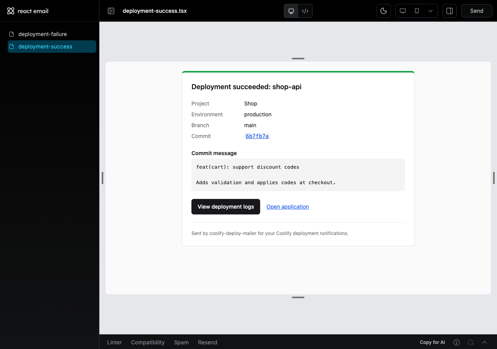
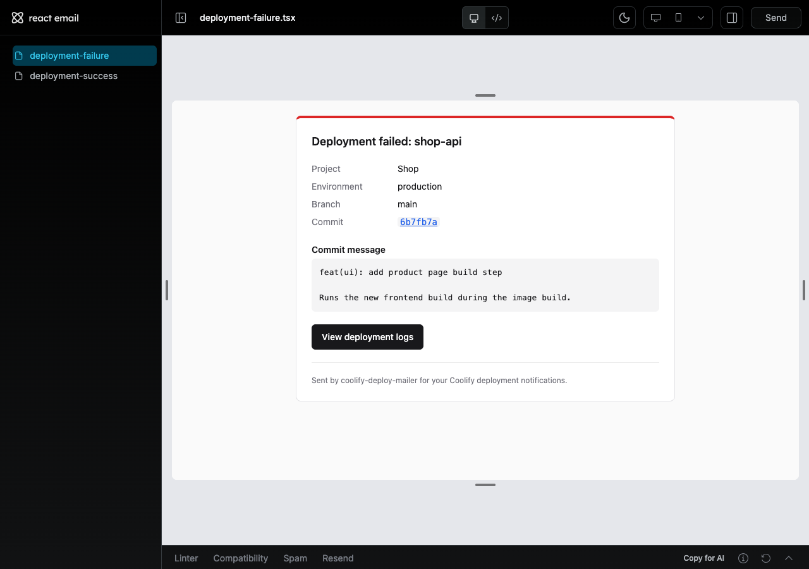

# coolify-deploy-mailer

Email your team **which commit was deployed**, every time a [Coolify](https://coolify.io)
deployment succeeds or fails.

Coolify's own deployment emails only say *"application X was deployed"*. This small, secure
service receives Coolify's **webhook** notifications, verifies each one with the Coolify
API, and sends an email with the branch, linked commit and commit message.

| Success | Failure |
|---|---|
|  |  |

## Features

- Commit SHA (linked to GitHub, GitLab, Bitbucket or Gitea), branch and commit message
- Links to the deployment logs and the running app
- **Zero-trust webhooks:** every webhook is verified with the Coolify API, and email content
  comes from Coolify, not the request
- Secret URL, optional IP allowlist, rate limiting, SMTP with TLS required, secrets
  redacted from logs
- Emails built with [React Email](https://react.email) + Tailwind, with a hand-written
  plain-text version
- Deduplication, retries with backoff, graceful shutdown
- 190+ tests, including attack scenarios; 100% line coverage
- Runs as a small, non-root, read-only Docker container. No database, no PM2.

## Quick start

**Deploying for your team?** Follow [docs/deployment.md](docs/deployment.md). It's step by
step, about 15 minutes, and needs no coding.

**Developing?**

```bash
npm install
cp .env.example .env     # see docs/configuration.md
npm run dev
npm run verify           # typecheck + lint + tests
npm run email:dev        # preview the emails at http://localhost:3030
```

## How it works

```
Coolify ──webhook──▶ secret + IP + rate limit + validation ──▶ 202
                                  │ (background)
                                  ▼
                 verify with Coolify API (deployment exists, same app, same status)
                                  ▼
                 build email from API data ──▶ React Email ──▶ SMTP (TLS) ──▶ your team
```

More detail is in [docs/architecture.md](docs/architecture.md).

## Documentation

| Guide | |
|---|---|
| [Deployment](docs/deployment.md) | Step-by-step setup in Coolify, operations, troubleshooting |
| [Configuration](docs/configuration.md) | Every environment variable |
| [Security](docs/security.md) | Threat model, protections, and the tests that prove them |
| [Architecture](docs/architecture.md) | Request lifecycle, folders, design decisions |
| [Email templates](docs/email-templates.md) | How emails are built, previewed and changed |
| [Logging](docs/logging.md) | Log format, levels, redaction, messages |
| [Testing](docs/testing.md) | Test layout, commands, end-to-end test with Coolify |
| [Development](docs/development.md) | Setup, scripts, code style, commits |
| [AGENTS.md](AGENTS.md) | Rules for AI coding agents and contributors |
| [CONTRIBUTING.md](CONTRIBUTING.md) · [SECURITY.md](SECURITY.md) | How to contribute, how to report vulnerabilities |

## Tech stack

Node.js 24 · TypeScript (strict) · Express 5 · Zod 4 · React Email · Nodemailer · pino ·
Helmet · Vitest · Biome · tsdown · husky + commitlint

## License

[MIT](LICENSE)
