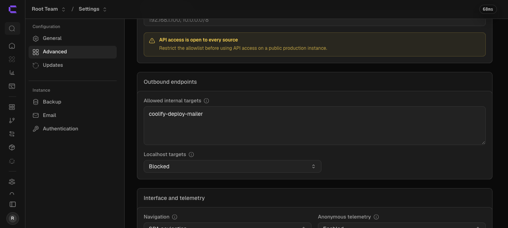
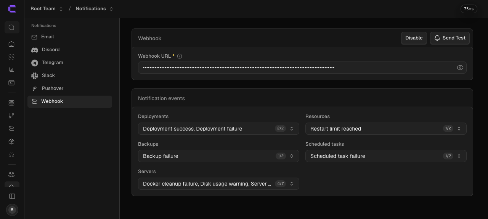
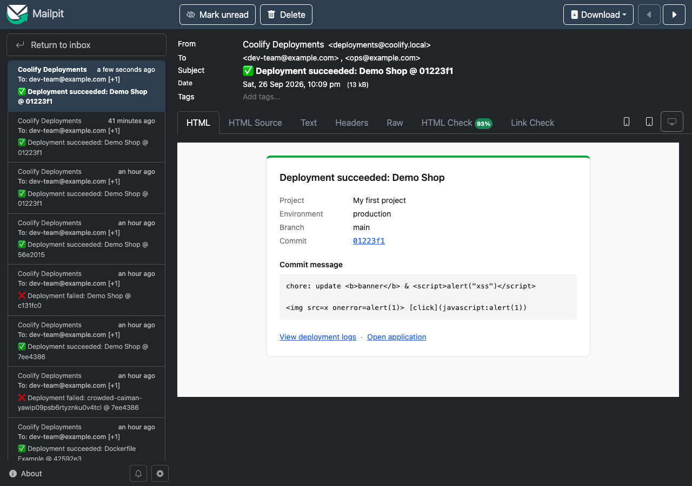
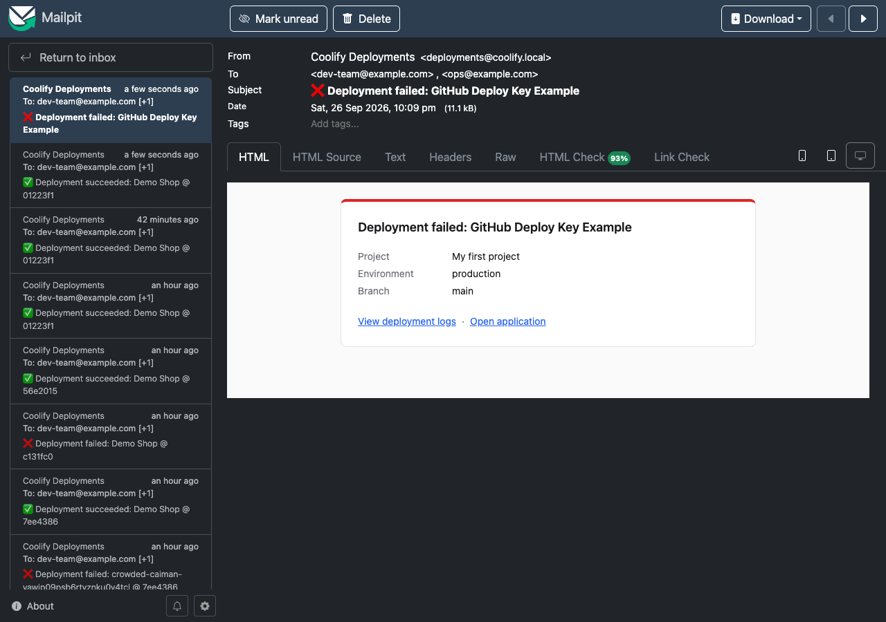

# Deployment guide

This guide sets up **coolify-deploy-mailer** so your team gets an email with the commit
details every time Coolify deploys an application.

- **Part A** is for everyone. It's point and click in the Coolify dashboard, and you don't
  need to be a developer.
- **Part B** is for DevOps: alternative hosting, operations, and security details.
- **Part C** covers troubleshooting.

It takes about 15 minutes.

---

## What you need before you start

| You need | Where to get it |
|---|---|
| Admin access to your Coolify dashboard | Your Coolify login |
| SMTP details for sending email (host, port, username, password, sender address) | Your email provider, e.g. Resend, Postmark, SendGrid, Amazon SES, Google Workspace or Microsoft 365 |
| The email addresses that should get the notifications | Your team |
| This project in a Git repository Coolify can reach | GitHub, GitLab or similar |

---

## Part A: Step-by-step setup in Coolify

### Step 1: Create a secret

The secret works like a password that goes in the webhook link. On any computer with a
terminal, run:

```bash
openssl rand -hex 32
```

Copy the result (64 characters) and keep it safe. We'll call it **YOUR_SECRET**.

> No terminal? Any password generator works. Use **at least 32 characters** and only
> letters, numbers, `-` and `_`.

### Step 2: Turn on the Coolify API and create a read-only token

The service uses this token to look up which commit was deployed.

1. In Coolify, open **Settings → Advanced**.
2. Under **API and MCP**, turn on **API access** and click **Save changes**.
   
3. Open **Keys & Tokens → API Tokens**.
4. Name the token `deploy-mailer`, leave **Permissions** as **Read** only, and click
   **Create Token**.
5. **Copy the token now.** It's only shown once. We'll call it **YOUR_API_TOKEN**.

### Step 3: Deploy the mailer as an application in Coolify

1. In Coolify, open the project you want (or create one called `Tools`) and click **+ New → Application**.
2. Choose the Git repository that contains this project.
3. For **Build Pack**, choose **Dockerfile**.
4. Under **Network**, set **Ports Exposes** to `3000`.
5. Give it a domain with HTTPS, for example `https://deploy-mailer.yourcompany.com`.
6. Under **Healthcheck**, turn it on with path `/health` and port `3000`.
7. Open **Environment Variables**, switch to **Developer view**, and paste in the block
   below. Replace every value in `<...>`:

   ```dotenv
   NODE_ENV=production
   PORT=3000
   LOG_LEVEL=info
   TRUST_PROXY=true

   WEBHOOK_SECRET=<YOUR_SECRET>
   # Recommended: only your Coolify server may call the webhook
   WEBHOOK_ALLOWED_IPS=<your Coolify server's IP>

   COOLIFY_URL=<https://your-coolify-dashboard.com>
   COOLIFY_API_TOKEN=<YOUR_API_TOKEN>
   GIT_BASE_URL=https://github.com

   SMTP_HOST=<smtp.your-provider.com>
   SMTP_PORT=587
   SMTP_SECURE=false
   SMTP_REQUIRE_TLS=true
   SMTP_USERNAME=<smtp username>
   SMTP_PASSWORD=<smtp password>
   MAIL_FROM=Coolify Deployments <deployments@yourcompany.com>
   MAIL_TO=<dev-team@yourcompany.com,ops@yourcompany.com>

   NOTIFY_ON_SUCCESS=true
   NOTIFY_ON_FAILURE=true
   ```

   Tick **Is Secret?** (or **Lock**) for `WEBHOOK_SECRET`, `COOLIFY_API_TOKEN` and
   `SMTP_PASSWORD`.
8. Click **Deploy** and wait for the status to turn green (**Running (healthy)**).
9. Check it: open `https://deploy-mailer.yourcompany.com/health` in your browser. You
   should see `{"status":"ok"}`.

> If the app doesn't start, open its **Logs**. A missing or wrong setting is reported
> clearly, for example `WEBHOOK_SECRET must be at least 32 characters`.

### Step 4: Connect Coolify's webhook to the mailer

1. In Coolify, open **Notifications → Webhook**.
2. In **Webhook URL**, enter:

   ```
   https://deploy-mailer.yourcompany.com/webhooks/coolify/<YOUR_SECRET>
   ```

3. Click **Save changes**, then **Enable**.
4. Under **Notification events → Deployments**, tick **both** **Deployment success** and
   **Deployment failure**, then click **Save changes**.
   
5. Click **Send Test**. The mailer's logs should show `Received Coolify test webhook`.
   The test doesn't send an email; that's expected.

> Coolify saves notification settings **per team**. If you use several teams, repeat
> Step 4 in each one.

### Step 5: Run a real test

1. Deploy any application that is connected to Git.
2. When it finishes, your team gets an email:

   | Success | Failure |
   |---|---|
   |  |  |

That's it. 🎉

> If a deployment fails *before* Coolify has downloaded the code (for example a wrong Git
> key), there is no commit yet. The failure email is still sent, just without the commit
> line.

> **Every webhook is double-checked.** Before sending, the mailer asks Coolify whether that
> deployment really exists, belongs to that app and has that status. Anything else is
> ignored, even if it comes with the right secret. See [security.md](security.md).

---

## Part B: For DevOps

### B1. How it works

1. Coolify's `SendWebhookJob` POSTs JSON to the webhook URL for `deployment_success` or
   `deployment_failed`.
2. The service checks the rate limit, the IP allowlist and the secret (in constant time),
   validates the payload, and answers **202** straight away.
3. In the background, it **verifies** the webhook with `GET /api/v1/deployments/{uuid}`: the
   deployment must exist, belong to the same application, and have the matching status
   (`finished` or `failed`). Then it loads `GET /api/v1/applications/{uuid}`.
4. It builds the email **from the API data** (name, links, commit), renders it with React
   Email, and sends it over SMTP with TLS.

See [architecture.md](architecture.md) for the full picture.

### B2. Other ways to host it

**Docker Compose on any server:**

```bash
git clone <this repo> && cd coolify-deploy-mailer
cp .env.example .env && nano .env         # fill in the values
docker compose up -d --build
docker compose logs -f
```

Put a TLS reverse proxy (Caddy, Traefik or nginx) in front of it. Only
`POST /webhooks/coolify/*` and `GET /health` need to be reachable.

**Private network instead of a public domain.** Coolify blocks webhooks to private IPs and
internal hostnames by default (to prevent SSRF). If the mailer runs on the same Docker
network as Coolify:

1. Use `http://<container-name>:3000/webhooks/coolify/<secret>` as the webhook URL.
2. In **Settings → Advanced → Outbound endpoints → Allowed internal targets**, add
   `<container-name>`.

This is how the local end-to-end test was run.

**PM2 is not needed.** The container is the process manager: Docker's restart policy (or
Coolify) restarts the service, and the Dockerfile has a `HEALTHCHECK`.

### B3. Configuration reference

| Variable | Required | Default | Notes |
|---|---|---|---|
| `WEBHOOK_SECRET` | ✅ | | 32+ characters of `[A-Za-z0-9_-]` |
| `COOLIFY_URL` | ✅ | | e.g. `https://coolify.example.com` (no `/api`) |
| `COOLIFY_API_TOKEN` | ✅ | | Read permission is enough |
| `COOLIFY_PUBLIC_URL` | | `COOLIFY_URL` | Browser URL of Coolify, used for "View deployment logs" links |
| `WEBHOOK_ALLOWED_IPS` | | *(any)* | IPs/CIDRs allowed to call the webhook, e.g. `203.0.113.7` |
| `SMTP_REQUIRE_TLS` | | `true` | Require STARTTLS before login; startup fails if a password would be sent without TLS |
| `SMTP_HOST` | ✅ | | |
| `MAIL_FROM` | ✅ | | `Name <address>` |
| `MAIL_TO` | ✅ | | Comma-separated list |
| `SMTP_PORT` | | `587` | `465` together with `SMTP_SECURE=true` |
| `SMTP_SECURE` | | `false` | `true` = implicit TLS (465); `false` = STARTTLS |
| `SMTP_USERNAME` / `SMTP_PASSWORD` | | | Must be set together |
| `GIT_BASE_URL` | | `https://github.com` | For repositories stored as `owner/repo`; set it for GitHub Enterprise |
| `NOTIFY_ON_SUCCESS` / `NOTIFY_ON_FAILURE` | | `true` | |
| `PORT` | | `3000` | |
| `LOG_LEVEL` | | `info` | `debug` for troubleshooting |
| `TRUST_PROXY` | | `false` | `true` behind Coolify/Traefik/Caddy, so rate limiting sees the real client IP |
| `WEBHOOK_RATE_LIMIT_PER_MINUTE` | | `60` | Per IP |
| `COOLIFY_API_TIMEOUT_MS` | | `10000` | |

Invalid configuration stops the service at startup and lists every problem. Every variable
is explained in [configuration.md](configuration.md).

### B4. Security checklist

- [ ] Serve the webhook over **HTTPS** only, since the secret is in the URL.
- [ ] Set `WEBHOOK_ALLOWED_IPS` to your Coolify server's IP (and `TRUST_PROXY=true` behind a
      proxy).
- [ ] Keep `SMTP_REQUIRE_TLS=true` (or use port 465 with `SMTP_SECURE=true`).
- [ ] The Coolify token has **Read** permission only (not *write*, *deploy* or *read:sensitive*).
- [ ] `WEBHOOK_SECRET`, `COOLIFY_API_TOKEN` and `SMTP_PASSWORD` are marked as secrets in Coolify.
- [ ] `.env` is never committed. `.gitignore` already excludes it.
- [ ] If Coolify's API allowlist is on (**Settings → Advanced → API and MCP**), add the
      mailer's IP.
- [ ] Run a single replica. Duplicate detection is kept in memory.

**Rotating secrets:**

- **Webhook secret:** set a new `WEBHOOK_SECRET`, redeploy, then update the URL in
  **Notifications → Webhook**. Deployments that finish between those two steps won't send
  an email.
- **API token:** create a new token, update `COOLIFY_API_TOKEN`, redeploy, then revoke the
  old token.

### B5. Operations

- **Health:** `GET /health` returns `200 {"status":"ok"}`.
- **Logs:** JSON lines (Pino). Useful messages:

  | Message | Meaning |
  |---|---|
  | `SMTP connection OK` | SMTP login works (checked at startup) |
  | `Deployment webhook accepted` | Webhook received; `status` is `queued`, `duplicate` or `disabled` |
  | `Deployment email sent` | Email delivered to the SMTP server (includes `commit`) |
  | `Sending email failed, retrying` | Temporary SMTP problem; it retries 4 times (2 s, 4 s, 8 s) |
  | `Webhook rejected: not sending an email` | The webhook didn't match Coolify's data (`reason`: `deployment-not-found`, `application-mismatch`, `status-mismatch`) or Coolify couldn't be reached (`coolify-unreachable`) |
  | `Blocked webhook from an IP that is not allowed` | A caller outside `WEBHOOK_ALLOWED_IPS` |
  | `Rejected invalid webhook payload` | Something sent malformed data |

- **Shutdown:** on `SIGTERM`, it stops accepting requests and finishes queued emails
  (up to 25 s).
- **Upgrading:** `git pull` and redeploy. Run `npm run verify` in CI before building.

### B6. Known limitations

- Coolify doesn't retry a webhook that got a non-2xx answer, and it doesn't sign
  webhooks. That's why the secret is in the URL and the service retries on its own side.
- **If the mailer is offline:** Coolify retries the webhook 5 times, 10 seconds apart, but
  only while the hostname still **resolves**. With a public domain, the email arrives once
  the mailer is back (verified). With an internal Docker hostname, a *stopped* container has
  no DNS entry, so Coolify drops the webhook straight away (also verified). Prefer a public
  HTTPS domain, and keep the restart policy on.
- Duplicate detection resets when the service restarts.
- Webhook settings are per team in Coolify.

---

## Part C: Troubleshooting

| Symptom | Check |
|---|---|
| No email at all | Coolify **Notifications → Webhook** is **enabled**, both deployment events are ticked, and the mailer's logs show `Deployment webhook accepted` |
| Coolify says the webhook URL "points to a local or private address" | Use the public HTTPS domain, or allow the host under **Settings → Advanced → Allowed internal targets** (see B2) |
| Logs show nothing when you click **Send Test** | The URL or secret is wrong (the mailer answers 404), or the domain isn't reachable from the Coolify server |
| No email, logs say `Webhook rejected … coolify-unreachable` | `COOLIFY_URL` or `COOLIFY_API_TOKEN` is wrong, API access is off in Coolify, or Coolify's API allowlist blocks the mailer. Emails are only sent for verified deployments. |
| No email, logs say `Blocked webhook from an IP that is not allowed` | Add your Coolify server's IP to `WEBHOOK_ALLOWED_IPS`; behind a proxy also set `TRUST_PROXY=true` |
| Email has no commit | The deployment failed before Coolify cloned the repository, so there is no commit yet |
| "View deployment logs" opens the wrong host | Set `COOLIFY_PUBLIC_URL` to the URL you use in the browser |
| The commit link points to the wrong host | Set `GIT_BASE_URL` (GitHub Enterprise or self-hosted GitLab) |
| `SMTP check failed` at startup | Wrong SMTP host, port or credentials. Port 465 needs `SMTP_SECURE=true`. |
| Emails land in spam | Use a `MAIL_FROM` domain that has SPF/DKIM set up with your SMTP provider |

---

## Appendix: Local test with Mailpit

The screenshots in this guide come from this setup, which runs Coolify's dev environment
with Mailpit:

```bash
docker build -t coolify-deploy-mailer .
docker run -d --name coolify-deploy-mailer --network <coolify-dev-network> \
  --env-file .env -p 3000:3000 --read-only --cap-drop ALL \
  --security-opt no-new-privileges:true coolify-deploy-mailer
# .env: SMTP_HOST=mailpit SMTP_PORT=1025 SMTP_REQUIRE_TLS=false
#       COOLIFY_URL=http://coolify:8080 COOLIFY_PUBLIC_URL=http://localhost:8000
# Coolify webhook URL: http://coolify-deploy-mailer:3000/webhooks/coolify/<secret>
# Allowed internal targets: coolify-deploy-mailer
# Mailpit inbox: http://localhost:8025
```

Scenarios verified end to end:

| # | Scenario | Result |
|---|---|---|
| 1 | Coolify **Send Test** | 200, logged, no email |
| 2 | Successful deployment | ✅ email with branch, linked commit and message |
| 3 | Failed deployment (clone error) | ❌ email without commit (no commit exists yet) |
| 4 | Wrong or missing secret, or GET | 404, no email |
| 5 | Not JSON, broken JSON, invalid fields, body > 32 kB | 415 / 400 / 400 / 413 |
| 6 | Same deployment delivered twice | Second one ignored (`duplicate`) |
| 7 | Other Coolify events (backups, servers, ...) | 202 `ignored` |
| 8 | Secret in logs | Never; shown as `[REDACTED]` |
| 9 | `docker stop` | Graceful shutdown, queued emails finish |

### Push-to-deploy scenarios

These use a throwaway local Git repository, served over smart HTTP on the `coolify` Docker
network, and deployed as the app **Demo Shop** (Dockerfile build pack). Each step is a
commit plus a deploy in Coolify:

| # | Commit | Deployment | Email |
|---|---|---|---|
| 10 | `7ee4386` *feat: first release of the demo shop* (with a body) | ✅ finished | ✅ subject `@ 7ee4386`, linked commit, full message including the body |
| 11 | `c131fc0` *feat(ui): add product page build step* (adds `RUN npm run build`) | ❌ build failed | ❌ **names the breaking commit** and its message |
| 12 | `56e2015` *fix(build): remove npm step…* (three paragraphs) | ✅ finished | ✅ paragraphs kept |
| 13 | `01223f1` message containing `<script>`, `` and `javascript:` | ✅ finished | ✅ shown as plain text; nothing runs or links |
| 14 | Redeploy while the mailer is **down** (hostname still resolves) | ✅ finished | ✅ arrived about 25 s later through Coolify's retry |
| 15 | Redeploy while the mailer container is **stopped** (internal hostname) | ✅ finished | ⚠️ none: Coolify drops the webhook (see B6) |


> GitHub/GitLab "auto deploy on push" can't reach a `localhost` Coolify, so in the local
> test each push is followed by clicking **Deploy**. In production, a push triggers the
> deployment by itself and the email follows automatically.
