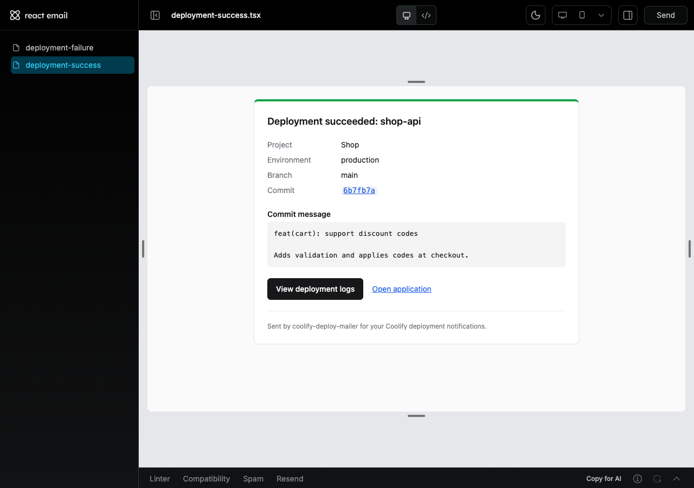

# Email templates

Emails are built with [React Email](https://react.email/docs) (the `react-email` package),
styled with its `Tailwind` component, and sent through nodemailer.



## How an email is made

```
DeploymentEmailData  (plain object, built from the Coolify API in services/deployment-email-data.ts)
        │
        ├─► emails/deployment-email-content.ts   subject, heading, preview text, detail rows, links
        │         (shared by both formats, so HTML and text always say the same thing)
        │
        ├─► emails/templates/deployment-email.tsx        HTML: React components
        │       EmailLayout ─ Html/Head/Preview/Tailwind/Body/Container + footer
        │       ├─ Heading
        │       ├─ DetailTable     Project, Environment, Branch, Pull request, Commit (CodeInline + Link)
        │       ├─ CommitMessage   pre-formatted text
        │       └─ ActionLinks     Button "View deployment logs" + Link "Open application"
        │
        └─► emails/templates/deployment-email-text.ts    plain text, written by hand
                     │
emails/render-deployment-email.tsx  →  { subject, html: await render(<DeploymentEmail/>), text }
```

## Choices that follow the React Email docs

| Guidance | What we do |
|---|---|
| Install the single `react-email` package with an exact version (`-E`) | `"react-email": "6.11.0"` |
| Set `lang`/`dir` on **both** `Html` and `Body` (some clients strip one) | `EmailLayout` sets both; a test checks it |
| Use `Tailwind` with `pixelBasedPreset`, because many clients ignore `rem` | `emails/tailwind-config.ts`; a test checks there are no `rem` units |
| A `Button` is a styled link | Main action "View deployment logs" |
| `CodeInline` for inline code that works in every client | The commit hash |
| Keep `Preview` text under 90 characters | `buildPreviewText()` trims to 90 |
| Convert components to HTML with `render` | `render(<DeploymentEmail data={…} />)` |

**Plain text:** React Email can make plain text with `render(…, { plainText: true })`, but
for this layout it merges table cells ("ProjectShop"), doubles the `CodeInline` value and
drops the commit message's line breaks. So `deployment-email-text.ts` writes the text
version by hand from the same content helpers.

**Security:** React escapes every value, so HTML in a commit message shows as text. Links go
through `toSafeHref()` (only `http:`/`https:`), and a missing or unsafe link is left out
instead of rendered empty.

## Preview while you edit

```bash
npm run email:dev        # opens http://localhost:3030 with live reload
```

The preview server shows every file in `src/emails/previews/`. Each preview is a
component with a **default export** (the preview CLI requires it; Biome allows default
exports only in that folder) that renders a template with realistic data from
`preview-data.ts`. Its bottom bar has **Compatibility** (email-client support), **Spam**
and **Linter** checks.

```bash
npm run email:export     # writes static HTML files to out/emails/ (git-ignored)
```

## Change a template

1. Edit a component in `src/emails/components/` or `src/emails/templates/`.
2. Add any new colours or fonts to `src/emails/tailwind-config.ts`. Avoid `rem`-based
   arbitrary values; use `[12px]` style values instead.
3. If the email shows new information, add it in `deployment-email-content.ts`, so the plain
   text version gets it too.
4. Check it with `npm run email:dev`.
5. Update the tests in `test/unit/emails/` and run `npm run verify`.

## Add a new email

1. Add its data type in `src/types/email.types.ts`.
2. Put content helpers in `src/emails/<name>-content.ts`.
3. Build the component in `src/emails/templates/<name>.tsx`, reusing `EmailLayout`,
   `DetailTable`, `CommitMessage` and `ActionLinks`.
4. Add a plain-text template and a `render<Name>Email()` function next to
   `render-deployment-email.tsx`.
5. Add a preview in `src/emails/previews/` and tests in `test/unit/emails/`.
